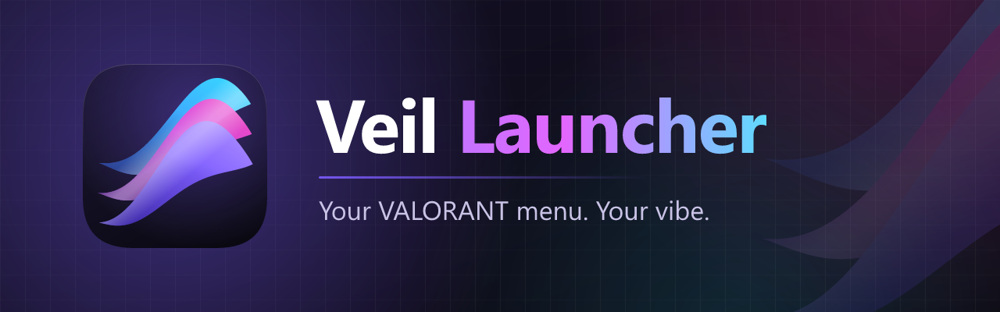
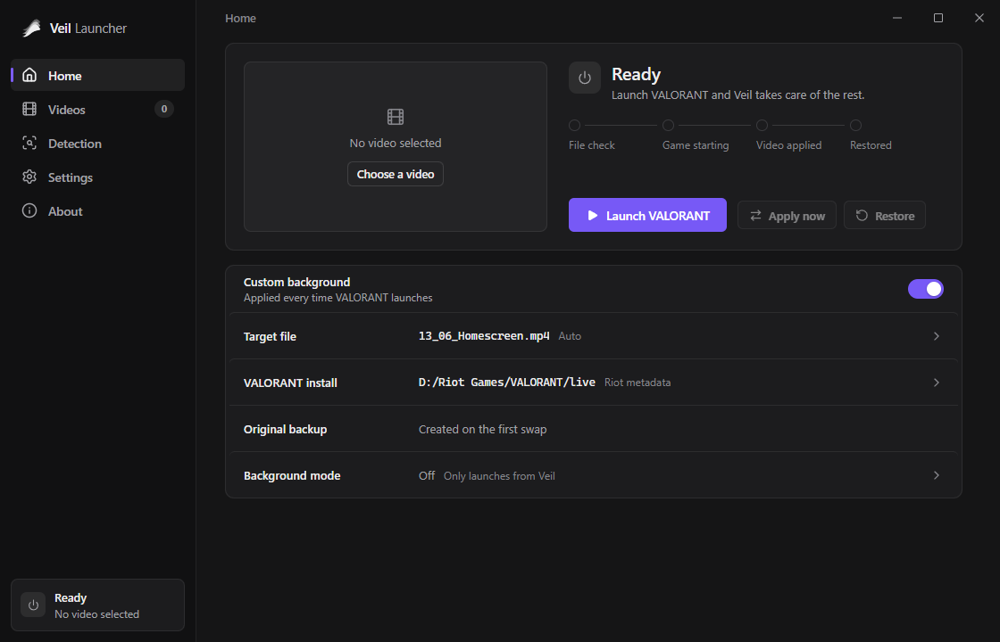
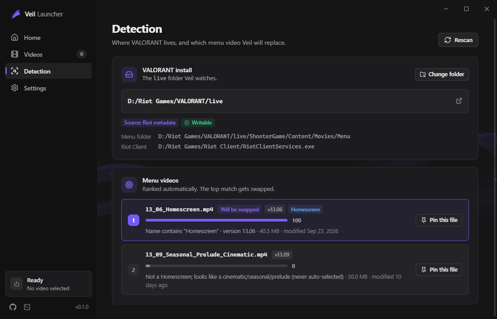
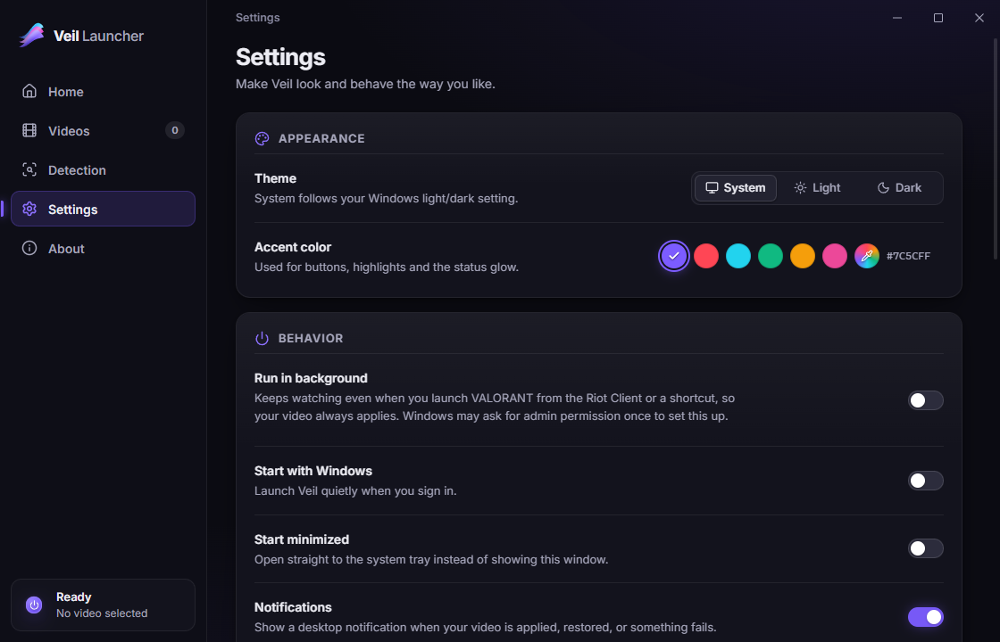
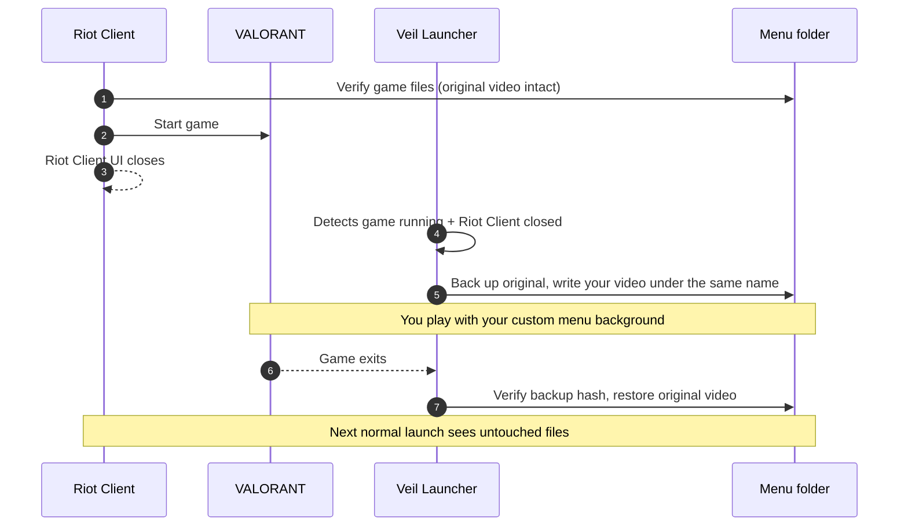

<div align="center">



<br>

[](https://github.com/ChirisaCasey/veil-launcher/releases/latest)
[](https://github.com/ChirisaCasey/veil-launcher/releases)
[](LICENSE)
[](#installation)
[](https://tauri.app)

**Swap VALORANT's main-menu background for any video you like, automatically and safely.**

[Download](https://github.com/ChirisaCasey/veil-launcher/releases/latest) · [Features](#features) · [How it works](#how-it-works) · [FAQ](#faq) · [Build from source](#build-from-source)

</div>

---

Veil Launcher is a small Windows tray app. It puts your own video in place of VALORANT's menu background **after** Riot's file check has finished, then puts the original back when the game closes. Normal launches never trigger a repair, and you never have to copy files by hand.

> [!NOTE]
> Veil only swaps a video file on disk. It does not inject code, draw an overlay or read game memory.

## Screenshots

<div align="center">



| Smart detection | Settings |
| :---: | :---: |
|  |  |

</div>

## Features

- **Smart detection.** Finds the menu video even when Riot renames it or adds a version prefix (`13_06_Homescreen.mp4`, `Homescreen_v2.mp4`, ...). Candidates are ranked and the reasoning is shown. You can pin a specific file to override the choice.
- **Swaps after Riot's file check.** Veil waits until VALORANT is running and the Riot Client window has closed, then swaps your video in.
- **Restores on exit.** The original goes back as soon as the game closes, so launching without Veil never triggers a repair or re-download.
- **Background mode (opt-in).** Keeps watching from the tray, so your video still applies when you start the game from the Riot Client or a desktop shortcut.
- **Start with Windows (opt-in).** Starts hidden in the tray.
- **Tray menu.** Launch VALORANT, change video, apply or restore, open settings, quit.
- **Any video format.** `.mp4` files go straight in. Optional ffmpeg conversion (one-click download) handles `.mkv`, `.mov`, `.webm` and more, with or without audio.
- **Themes.** Light, dark or follow-system, with a custom accent color.
- **Safe backups.** The original is backed up before the first swap and checked by hash before every restore. If Veil or your PC crashes mid-session, the original is restored the next time Veil starts.

## How it works



The target lives in `<VALORANT>\live\ShooterGame\Content\Movies\Menu`. Veil writes your video under the exact filename the game expects, so nothing else changes.

## Installation

1. Download `Veil.Launcher_x.y.z_x64-setup.exe` from the latest **[Release](https://github.com/ChirisaCasey/veil-launcher/releases/latest)**.
2. Run it and follow the prompts (it installs for all users, so Windows asks for admin once).

> [!IMPORTANT]
> Builds are not code-signed yet, so Windows SmartScreen may show *"Windows protected your PC"*. Click **More info**, then **Run anyway**. You can check the source and the release workflow in this repo before running it.

Requirements: Windows 10 or 11 (64-bit) and WebView2, which ships with Windows 11 and current Windows 10. The installer fetches it if it is missing.

## Usage

1. **Open Veil Launcher.** It finds your VALORANT install automatically. If it can't, set the folder in **Settings**.
2. **Add a video.** On **Videos**, drop in an `.mp4`, or any other format with ffmpeg conversion turned on.
3. **Select it** and make sure the main switch on **Home** is on.
4. **Launch.** Click **Launch VALORANT** in the app or tray. Veil waits for the file check and then swaps.
5. **Play.** When you quit the game, the original is restored automatically.

Tip: turn on **Background mode** if you usually start the game from the Riot Client.

## Settings

| Setting | What it does |
| --- | --- |
| **Swap trigger** | When the swap happens. **As soon as VALORANT starts** (default, recommended): Riot checks the game files before the game process starts, so Veil swaps right after launch. **After the Riot Client closes**: also waits for the Riot Client window to close; if your client stays open after launch, it swaps once the game has been running for 15 seconds. |
| **Swap delay** | Extra wait (0–60 s) after the trigger fires. Raise it if the game ever repairs the file on a slow drive. |
| **Background mode** | Keeps a lightweight watcher running so swaps also happen when the game is launched outside Veil. |
| **Start with Windows** | Starts Veil at sign-in. Uses a scheduled task when admin rights are needed, otherwise a per-user startup entry. |
| **Start minimized** | Starts hidden in the tray. |
| **Target file** | Auto-detected by default. Pin a specific file from the detection list to override. |
| **Install folder** | Override the auto-detected `VALORANT\live` folder. |
| **Keep audio** | Keep the audio track when converting with ffmpeg. |
| **Notifications** | Desktop notifications on swap, restore and errors. |
| **Theme / Accent** | Light, dark or system, plus an accent color. |

## FAQ

<details>
<summary><b>Is it safe? Can I get banned?</b></summary>

Veil only replaces a video file that the game ships, and only while the game runs. Nothing is injected, hooked, overlaid or read from the game process, and the file is put back afterwards. That said, this is an unofficial tool that Riot has not endorsed, so **use it at your own risk**.
</details>

<details>
<summary><b>Why does it ask for admin?</b></summary>

The VALORANT folder is often in a protected location, such as `C:\Riot Games` or under `Program Files`, depending on how it was installed. Veil asks for elevation only when it needs to write there. If your game folder is writable, it never asks.
</details>

<details>
<summary><b>What happens when VALORANT updates?</b></summary>

Veil rescans the Menu folder every time, so a renamed or re-prefixed file is picked up automatically. If you pinned a file that no longer exists, Veil falls back to auto-detection and tells you. Because the original is always restored after you play, Riot's patcher only ever sees untouched files.
</details>

<details>
<summary><b>Where are backups stored?</b></summary>

In `%APPDATA%\VeilLauncher\backups`. Your video library is in `%APPDATA%\VeilLauncher\videos`.
</details>

<details>
<summary><b>How do I uninstall cleanly?</b></summary>

Use **Settings → Apps → Veil Launcher → Uninstall** (or the Start-menu uninstaller). It restores the original menu video and removes the background task and startup entry before deleting the app. To remove your library and backups as well, delete `%APPDATA%\VeilLauncher` afterwards.
</details>

<details>
<summary><b>The game re-downloaded the video / shows the default background.</b></summary>

Something put the original back after the swap. Increase **Swap delay** a few seconds, or switch the trigger to **After the Riot Client closes**. You can also click **Apply now** while the game is running.
</details>

## Lite version

Prefer a single script? **[Val-Patcher](https://github.com/ChirisaCasey/Val-Patcher)** is a lightweight `.bat` that does the core swap so you can see exactly what happens under the hood.

## Build from source

**Prerequisites:** [Node.js 20+](https://nodejs.org), [Rust stable](https://rustup.rs), [Microsoft C++ Build Tools](https://visualstudio.microsoft.com/visual-cpp-build-tools/) ("Desktop development with C++") and [WebView2](https://developer.microsoft.com/microsoft-edge/webview2/). See the [Tauri prerequisites](https://tauri.app/start/prerequisites/).

```powershell
git clone https://github.com/ChirisaCasey/veil-launcher.git
cd veil-launcher
npm install

npm run tauri dev      # run the app with hot reload
npm run tauri build    # build installers into src-tauri/target/release/bundle/

npm run check                 # type-check the UI
cd src-tauri && cargo test    # Rust unit tests
```

Running `npm run dev` on its own serves the UI in a browser with a mocked backend, which is handy for UI work.

Releases are built by [GitHub Actions](.github/workflows/release.yml). Push a `v*` tag and a draft release with both installers is created.

## Project structure

```
src/                 SvelteKit UI (Svelte 5, TypeScript)
  lib/api.ts         UI <-> Rust command contract (single source of truth)
  lib/mock.ts        Browser mock of the backend for `npm run dev`
src-tauri/           Rust backend (Tauri 2): detection, watcher, swap/restore, tray
  windows/hooks.nsh  Installer hooks (restore original on uninstall)
  icons/             Generated app icons
assets/              Brand sources (icon, banner) and render scripts
docs/                Screenshots and docs
.github/             CI, release workflow, issue templates
```

## Contributing

Issues and pull requests are welcome.

1. Open an [issue](https://github.com/ChirisaCasey/veil-launcher/issues) first for larger changes.
2. Keep the hard rule: **file swapping only**. No injection, hooking, overlays or memory access.
3. Make sure `npm run check`, `cargo test` and `cargo clippy -- -D warnings` pass.
4. If you change the command surface, update `src/lib/api.ts` and the Rust side together.

## License

[MIT](LICENSE) © 2026 Veil Launcher contributors

## Disclaimer

Veil Launcher is not affiliated with, endorsed, sponsored or approved by Riot Games, Inc. VALORANT and Riot Games are trademarks or registered trademarks of Riot Games, Inc. All other trademarks belong to their respective owners.
